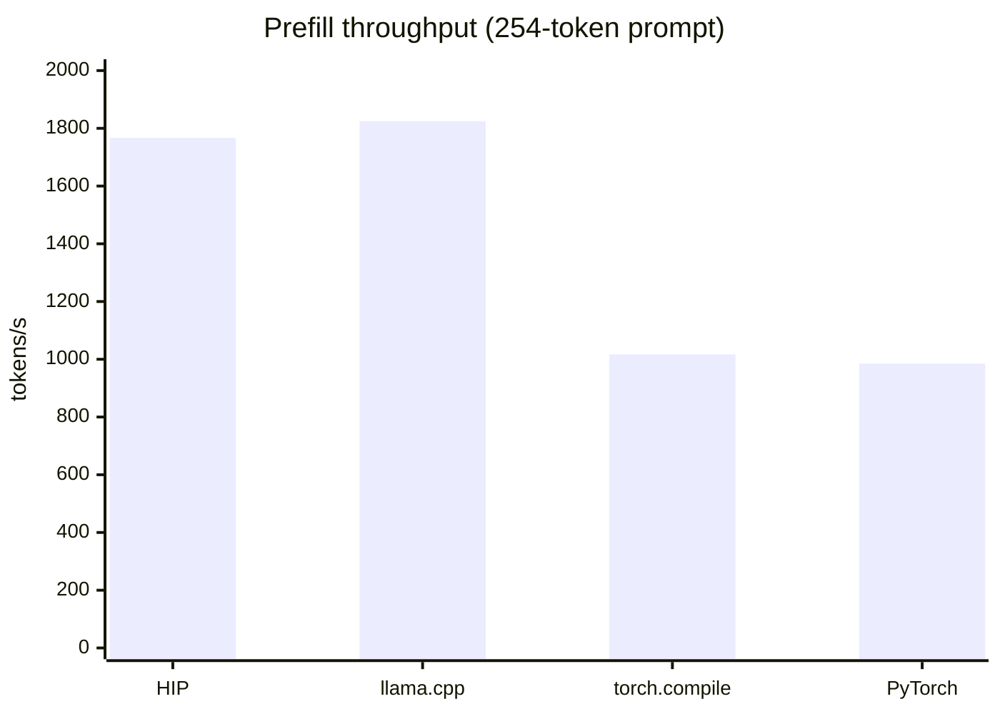
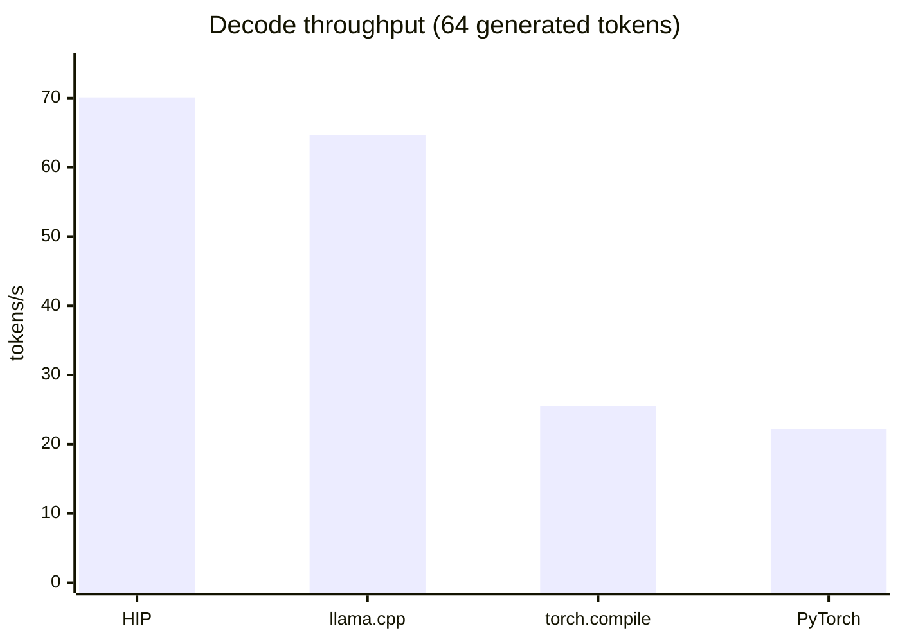
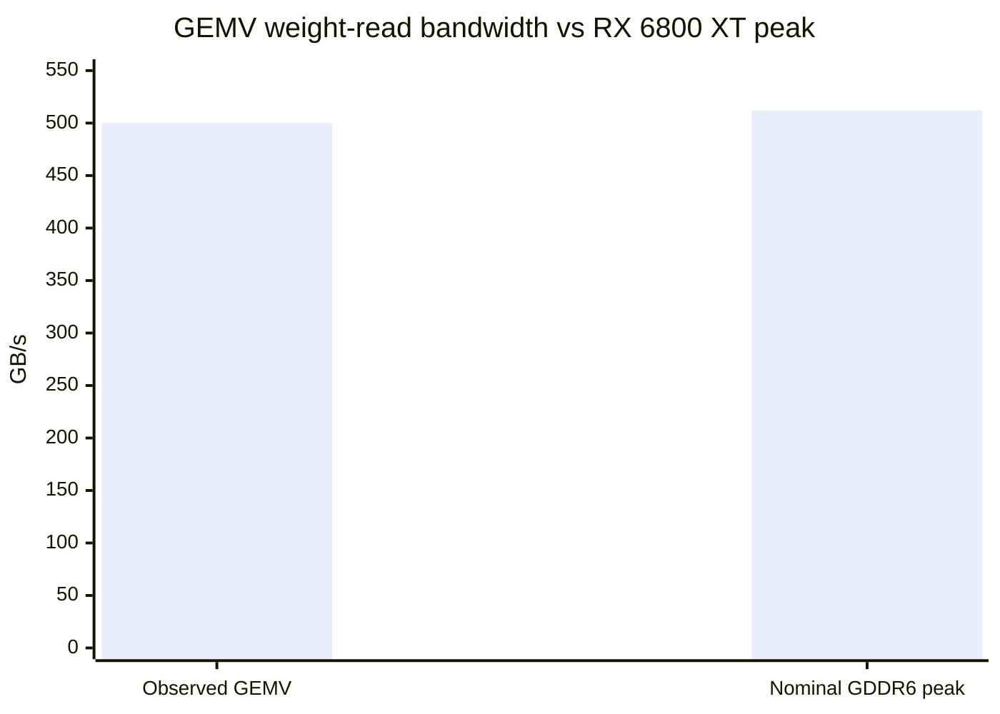
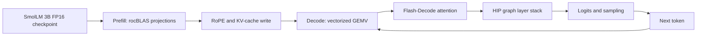

# SmolLM 3B inference on AMD Radeon RX 6800 XT

A from-scratch C++23 inference engine for **HuggingFaceTB/SmolLM3-3B**, optimized for an AMD Radeon RX 6800 XT (`gfx1030`). It runs FP16 weights and activations through custom HIP kernels and rocBLAS, with a KV-cached decode path designed to keep single-token generation fast.

## Contents

- [Performance](#performance)
- [Implementation](#implementation)
- [Key optimization decisions](#key-optimization-decisions)
- [Build and run](#build-and-run)
- [Reproduce the comparison](#reproduce-the-comparison)
- [Profile](#profile)

## Performance

One recorded run with a 254-token prompt and 64 generated tokens:

| Engine | Prefill (tok/s) | Decode after first token (tok/s) |
| --- | ---: | ---: |
| Custom C++ HIP, RX 6800 XT | 1,767 | **70.1** |
| llama.cpp HIP, RX 6800 XT | **1,825** | 64.6 |
| PyTorch `torch.compile` | 1,017 | 25.5 |
| PyTorch eager | 985 | 22.2 |





The custom engine's decode result is about **2.75× `torch.compile`** and **1.09× llama.cpp** in these saved runs. The PyTorch and custom results come from the same comparison run; the llama.cpp result is a separate capture with the same model and token counts. Its timing is client wall-clock over HTTP streaming, so it includes server and transport overhead. Treat these as representative measurements, not a multi-run statistical comparison: each saved run used one warmup and one measured repetition.

Profiling the optimized GEMV path showed roughly **500 GB/s observed weight-read bandwidth**. AMD specifies up to **512 GB/s** of memory bandwidth for the RX 6800 XT, so this is approximately **98% of the card's nominal GDDR6 bandwidth** for those GEMV reads ([AMD specifications](https://www.amd.com/content/dam/amd/en/documents/partner-hub/radeon/amd-radeon-rx-6000-series-quick-reference-competitive.pdf)). This is an approximate roofline comparison for the GEMV kernels, not a claim that the full model or GPU sustains 98% utilization. The benchmark and llama.cpp setup are documented in [benches/LLAMA_CPP.md](benches/LLAMA_CPP.md); saved measurements are in [benches/comparison.json](benches/comparison.json), [benches/cpp_bench.json](benches/cpp_bench.json), and [benches/llama_bench.json](benches/llama_bench.json).



## Implementation

- Custom HIP kernels for RMSNorm, RoPE and KV-cache writes, grouped-query attention, SwiGLU, embeddings, argmax, and vectorized decode GEMV projections.
- rocBLAS matrix multiplications for prefill; custom matrix-vector kernels for single-token decode, including fused Gate/Up plus SwiGLU.
- Chunked Flash-Decode attention with partial-result merging and HIP graph replay for the decode layer stack.
- FP16 KV cache, interactive chat executable, GPU kernel tests, and a benchmark harness for PyTorch eager, `torch.compile`, the custom engine, and llama.cpp.



## Key optimization decisions

**Use GEMM for prefill and GEMV for decode.** Prefill processes many prompt tokens together, so rocBLAS GEMMs reuse weights across rows of activations. Decode processes one new token at a time; custom GEMVs avoid treating that single vector as a larger matrix operation. The decode path applies GEMV to QKV, attention output, MLP projections, and the LM head.

**Cache keys and values.** Prefill writes each layer's K/V tensors into an FP16 cache. Each decode step computes and appends K/V only for the new token, then attends over the existing cache instead of projecting the entire history again.

**Parallelize attention over long contexts.** Flash-Decode divides the cached context into chunks, computes partial attention results independently, then merges their softmax state and output. This exposes more parallel work for a single query token.

**Reduce decode memory and launch overhead.** Vectorized GEMV loads weight data in wide transactions and accumulates in FP32. Gate and Up projections are fused with SwiGLU to avoid materializing and rereading the full gate/up activation. HIP graph replay captures the layer stack to reduce host dispatch overhead; its performance is measured separately because graph replay did not improve every tested workload.

## Build and run

Requirements: Linux, an AMD GPU supported by the installed ROCm version, ROCm/HIP with rocBLAS, xmake, a C++23-capable compiler, and Cargo for the tokenizer wrapper.

```bash
xmake f -m release
xmake build llm_engine benchmark_engine test_kernels
```

Export the Hugging Face checkpoint into the engine's packed FP16 format:

```bash
python3 -m venv .venv
.venv/bin/pip install -r python/requirements.txt
.venv/bin/python python/export_weights.py \
  --model HuggingFaceTB/SmolLM3-3B --output weights.bin
```

Start chat or run the model and kernel validation suite:

```bash
xmake run llm_engine "$PWD/weights.bin"
xmake run test_kernels "$PWD/weights.bin"
```

## Reproduce the comparison

```bash
.venv/bin/python benches/benchmark.py \
  --model HuggingFaceTB/SmolLM3-3B \
  --weights weights.bin \
  --max-tokens 64 \
  --llama-gguf benches/SmolLM3-3B-F16.gguf
```

The harness uses shared prompt token IDs and greedy sampling. PyTorch eager and compiled results are cached by model, prompt, settings, and device environment; use `--refresh-pytorch-cache` to rerun them. The custom and llama.cpp runs are executed separately so each can release its GPU allocations before the next engine starts. See [benches/LLAMA_CPP.md](benches/LLAMA_CPP.md) for llama.cpp build and timing details.

## Profile

```bash
/opt/rocm/bin/rocprofv3 \
  --kernel-trace --hip-trace --marker-trace --stats --output-format csv pftrace \
  --output-directory /tmp/llm-profile \
  -- ./build/linux/x86_64/release/benchmark_engine \
  weights.bin 64 /tmp/llm-profile-results.json benches/profile_tokens.json 1 1
```

Omit `--kernel-rename` when profiling graph replay to preserve actual kernel symbols. rocprof2 counter availability varies across GPUs and counter blocks.
